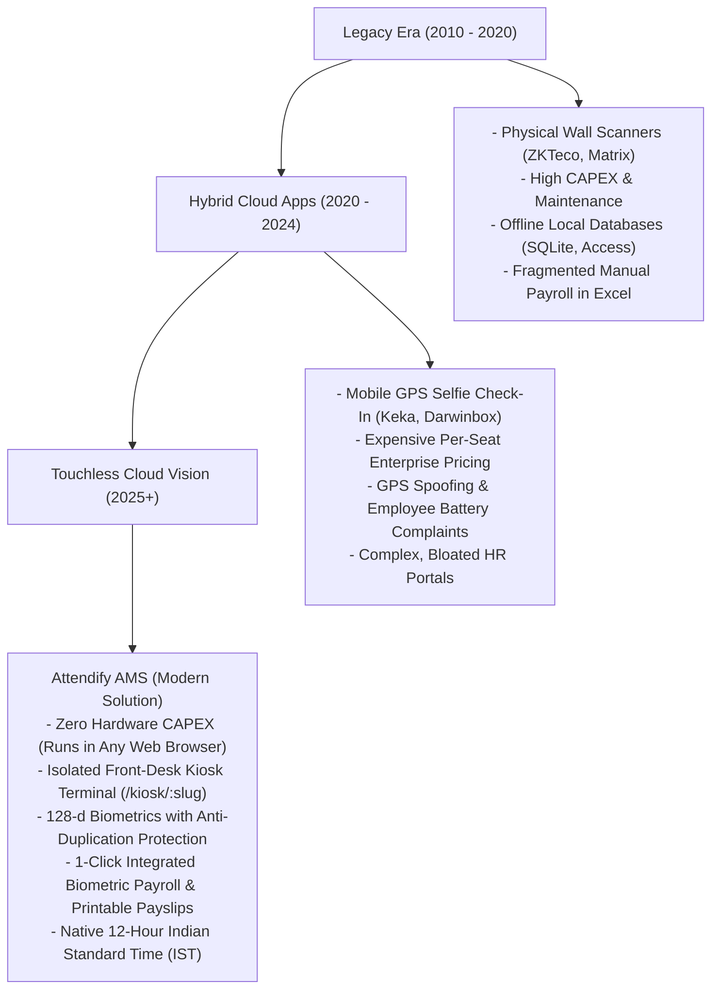
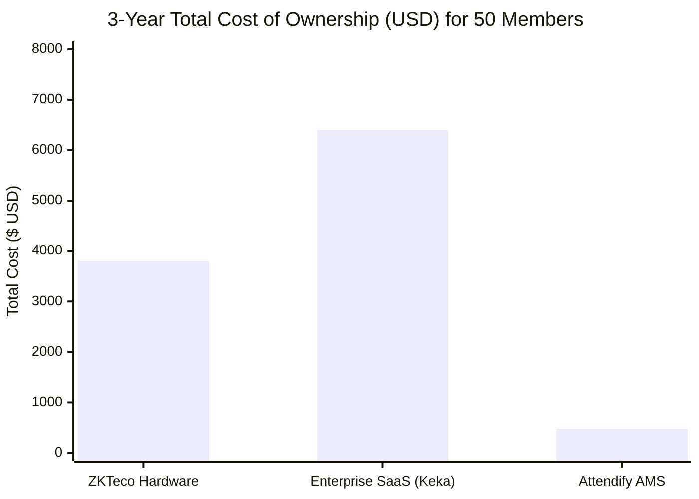

# Market & Competitor Analysis
**Product:** Attendify AMS (Modern Cloud Biometric Attendance & Payroll Platform)  
**Version:** 3.0.0 (Production Release)  
**Focus Market:** Small-to-Mid Sized Enterprises (SMEs), Co-Working Spaces, Tech Startups, Colleges & Educational Institutions  
**Document Classification:** Strategic Market Assessment & Competitive Benchmarking  

---

## 1. Executive Market Assessment

The Global Workforce Management and Time & Attendance software market is experiencing a significant structural transition. Organizations are moving away from dedicated wall-mounted biometric fingerprint terminals toward **touchless, cloud-native computer vision platforms**.

### The Three Critical Industry Challenges Solved by Attendify AMS:
1. **Hardware CAPEX & Maintenance Overhead:** Traditional fingerprint and RFID machines cost between \$300 and \$1,500 per terminal, require physical LAN cabling, and degrade rapidly in dusty environments. Attendify AMS operates directly on any tablet, iPad, smartphone, or laptop webcam.
2. **Confidentiality & Role Privacy Leaks:** Standard web systems often expose HR payroll tabs or employee lists to whoever operates the front-desk machine. Attendify AMS's dedicated Kiosk Portal (`/kiosk/:orgSlug`) enforces strict JWT scoping and PIN gating—employees can punch in and self-enroll, while payroll and salary data remain locked behind `@admin_only` security.
3. **Ghost Employees & Multiple Profiles:** Many vision systems fail to check if a new applicant's face already exists under another name. Attendify AMS executes mathematical pairwise vector comparison during enrollment to guarantee single biometric identity per individual.

---

## 2. In-Depth Competitor Breakdown

### 2.1 Category A: Traditional Biometric Hardware Manufacturers
*Representatives: ZKTeco, Matrix Comsec, eSSL, Realtime Biometrics*

- **Value Proposition:** Physical standalone devices mounted on office walls with optical fingerprint or infrared face sensors.
- **Strengths:** High physical familiarity; independent of local network browser crashes.
- **Critical Weaknesses:**
  - **High Upfront CAPEX:** Minimum \$300–\$1,200 per device plus mounting and electrical costs.
  - **Proprietary Firmware & Fragile Sync:** Sync software runs on local Windows server instances that frequently drop records when the office internet disconnects.
  - **No Integrated Modern SaaS:** Attendance data must be exported manually via USB drive or scheduled CSV tasks before payroll can be run.
  - **Sensor Degradation:** Optical glass sensors suffer scratches and failed reads over time, leading to long entry queues.

### 2.2 Category B: Enterprise HR & Payroll Giants
*Representatives: Darwinbox, Keka HR, Zoho People, GreytHR*

- **Value Proposition:** All-in-one Human Resource Management Systems (HRMS) covering recruitment, performance management, leaves, and payroll.
- **Strengths:** Mature multi-state compliance features, complex tax deductions (PF, ESI, TDS), enterprise integrations.
- **Critical Weaknesses:**
  - **Prohibitive Pricing & Long Contracts:** Cost \$2 to \$6 per employee per month with 50–100 minimum seat mandates. A 50-person company pays \$1,200–\$3,600 annually just for basic tracking.
  - **Feature Bloat:** 80% of features (appraisals, 360-degree feedback, ATS recruitment) are unused by schools, coaching centers, and modern startups that simply need reliable attendance and compensation.
  - **Mobile GPS Spoofing Vulnerabilities:** Relying on employees' personal phones for "selfie + GPS check-ins" encourages mock location spoofing apps and causes employee friction regarding privacy and battery consumption.
  - **Lack of Dedicated Reception Kiosks:** Enterprise mobile apps require individual smartphone logins for each intern/student, which is unworkable for institutions where students cannot carry phones into classrooms.

### 2.3 Category C: Legacy On-Premise AMS Tools
*Representatives: TimeWatch, local bespoke Visual Basic / C# tools*

- **Value Proposition:** Desktop Windows applications running on local SQLite or MS Access databases.
- **Strengths:** No internet connection required for basic operation.
- **Critical Weaknesses:**
  - **Zero Cloud Multi-Tenancy:** Data cannot be monitored remotely by business owners.
  - **Database Fragility:** SQLite/Access databases suffer corruption under concurrent access and lack disaster recovery.
  - **Dated User Experience:** Visual design dating back to Windows XP era with zero employee self-service capabilities.

---

## 3. Feature Comparison Matrix

| Evaluation Dimension | Traditional Hardware (ZKTeco / eSSL) | Enterprise HRMS (Keka / Darwinbox) | Legacy Desktop AMS | **Attendify AMS (Modern SaaS)** |
| :--- | :--- | :--- | :--- | :--- |
| **Hardware Requirement** | Specialized Proprietary Scanners | Employee Personal Smartphones | Windows PC with USB Reader | **Any Device (Tablet, Phone, Laptop Camera)** |
| **Upfront CAPEX** | High (\$300 – \$1,500) | Low (Software only) | Moderate (Scanner hardware) | **Zero (\$0 — Uses Existing Hardware)** |
| **Multi-Tenant Cloud DB** | No (Local server / manual sync) | Yes (Cloud hosted) | No (Local SQLite / Access) | **Yes (Managed PostgreSQL 16)** |
| **Dedicated Kiosk Portal** | Only on physical device | Rare / Complex setup | No | **Yes (`/kiosk/:orgSlug` + 6-digit PIN)** |
| **Confidential Data Isolation** | No UI at device level | Full app login required | Single admin screen | **Strict JWT Scoping (`@admin_only` 403)** |
| **Biometric Engine** | Proprietary on-chip optical | Third-party cloud selfie | Fingerprint optical matching | **128-d Computer Vision Vector Matching** |
| **Duplicate Face Prevention** | Limited to device memory | Not enforced cross-profile | Fingerprint duplicate check | **Pairwise Vector Check ($\min D < 0.35$)** |
| **Check-In Photo Proof** | Low-res Infrared (often hidden) | Selfie snapshot | No photo stored | **Full HD Snapshot Proof with Modal Review** |
| **Permanent Snapshot Retention** | Overwrites on cyclic memory | Retained in cloud | None | **Permanent Storage (Never deleted on checkout)** |
| **Automated Biometric Payroll** | No (Requires third-party sync) | Yes (Complex workflow) | No (Manual Excel export) | **Yes (1-Click Hours $\to$ LOP $\to$ Net Pay)** |
| **Printable Branded Payslips** | No | Yes | No | **Yes (Printable Attendify Payslip Modal)** |
| **Time Format** | 24-Hour Military Time | Configurable | 24-Hour Military Time | **Native 12-Hour IST (`hh:mm:ss AM/PM`)** |
| **Deployment Time** | 2 – 5 Days (Installation & wiring) | 2 – 4 Weeks (Onboarding) | 1 – 2 Days | **< 5 Minutes (Web URL + Cloud Setup)** |

---

## 4. Total Cost of Ownership (TCO) & ROI Comparison

### Scenario: 50-Member Organization over a 3-Year Lifecycle

1. **Traditional Biometric Hardware (ZKTeco):**
   - 2 Terminals (Front entrance & rear exit): \$1,200
   - Installation, cabling, static IP configuration: \$400
   - Annual Maintenance Contract (AMC) & hardware replacements (3 years): \$1,000
   - Third-party payroll software subscription (\$30/month): \$1,080
   - **Total 3-Year TCO:** **\$3,680 – \$4,200**

2. **Enterprise HR SaaS (Keka / Darwinbox):**
   - 50 seats @ \$3.50/seat/month: \$175/month
   - Implementation & onboarding setup fee: \$500
   - Annual subscription for 3 years: \$6,300
   - **Total 3-Year TCO:** **\$6,800 – \$7,500**

3. **Attendify AMS (Cloud Architecture):**
   - Hardware: \$0 (Runs on existing reception tablet or laptop)
   - Infrastructure (Render Web Service + PostgreSQL + Vercel): \$0 – \$14/month
   - Implementation & setup fee: \$0
   - **Total 3-Year TCO:** **\$0 – \$504**
   - **Net Financial Savings:** **87% to 93% reduction in capital expenditure!**

---

## 5. Strategic Recommendations & Commercial Positioning

### 5.1 Immediate Competitive Moats
1. **The "Kiosk-as-a-Link" Innovation:**
   Competing SaaS platforms make kiosk deployment painful by demanding complex mobile MDM software or native Android APK installations. Attendify AMS's `/kiosk/:orgSlug` link with a 6-digit PIN works on any browser instantly—turning an iPad, Amazon Fire Tablet, or receptionist laptop into an enterprise biometric terminal in 10 seconds.
2. **True Confidential Data Isolation:**
   Unlike competitors where the front-desk operator can often see everyone's salary or sensitive attendance logs, Attendify AMS guarantees that kiosk tokens are restricted to check-in/out and self-enrollment.
3. **Turnkey Biometric Payroll:**
   Connecting punch-in times directly to salary formulas, LOP deductions, and branded printable payslips eliminates the manual "export to Excel $\to$ calculate formula $\to$ generate PDF" loop that plagues small business owners.

### 5.2 Product Roadmap Recommendations (Next Horizons)
- **Phase 1 (Mobile PWA & Offline Sync):** Register a Service Worker on `/kiosk/:orgSlug` to allow offline face vector matching when reception Wi-Fi briefly drops, syncing records upon reconnection.
- **Phase 2 (Automated WhatsApp & Email Notifications):** Dispatch instant WhatsApp/SMS notifications to parents/employers upon student punch-in (`"Om Parkhi checked in at 09:14 AM IST"`).
- **Phase 3 (Multi-Branch Management):** Allow large organizations to manage multiple office branches under one consolidated tenant, tracking branch-level attendance across different kiosk slugs.

