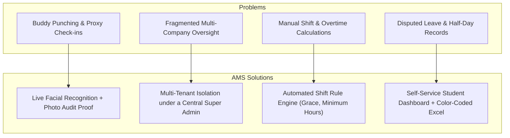
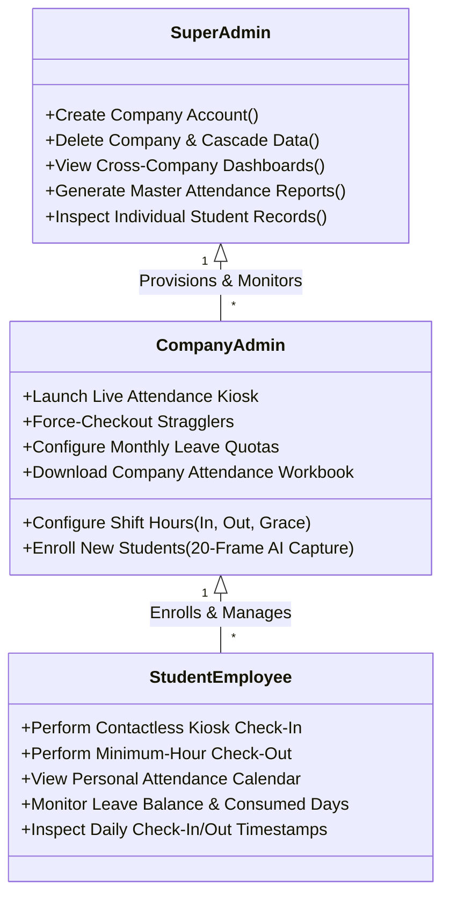
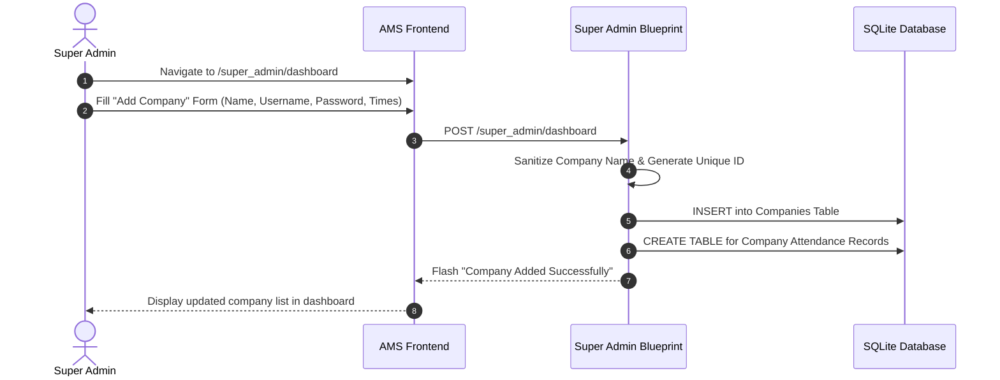
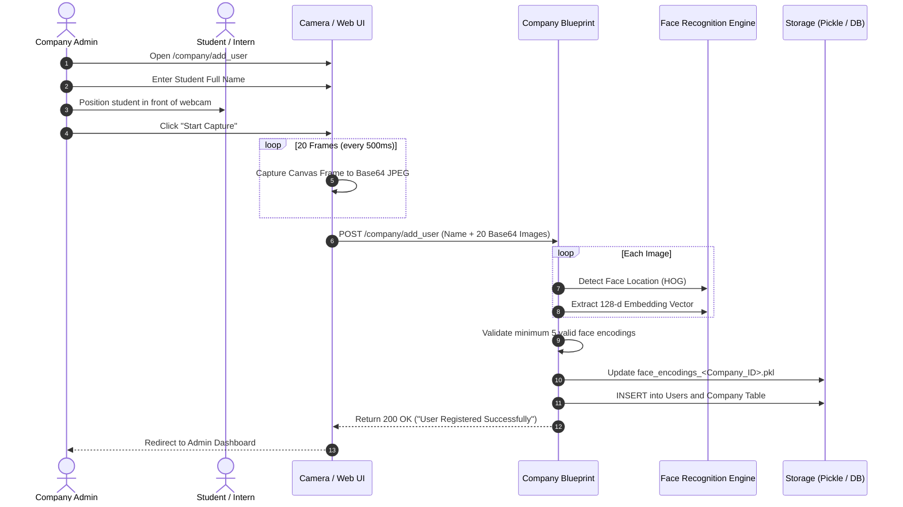
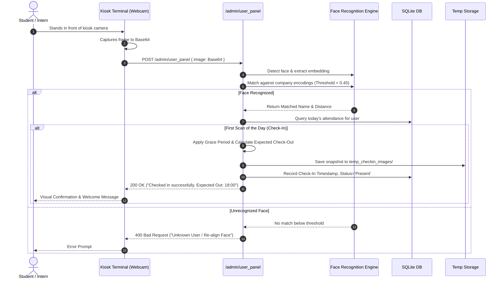
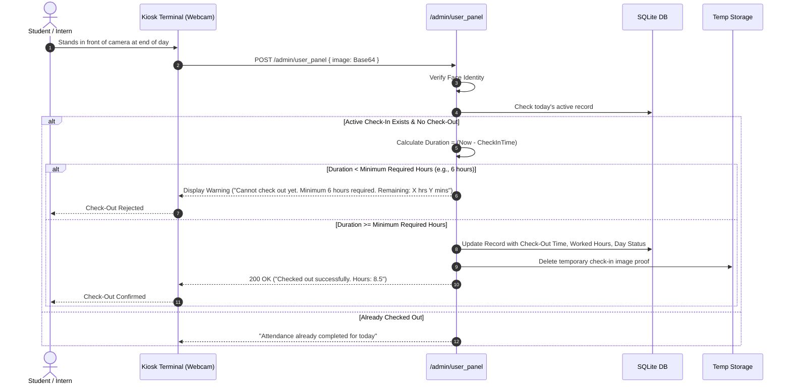
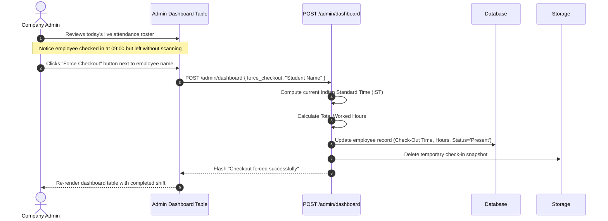

# AI Attendance Management System (AMS)
## Product Vision, Requirements, Features & User Flow Specification

---

## 1. Executive Summary & Product Vision

### 1.1 Product Overview
The **AI Attendance Management System (AMS)** is a multi-tenant, contactless biometric attendance and workforce analytics platform. Built to support organizations managing distributed student cohorts, interns, and employees across multiple client companies and academic departments, AMS replaces manual paper sign-in sheets, magnetic swipe cards, and dedicated fingerprint scanners with browser-based computer vision.

By utilizing standard webcams and mobile/tablet cameras, AMS extracts 128-dimensional facial embeddings to identify users in real time, logs attendance records, enforces organization-specific shift policies, and computes work durations—all within a centralized cloud/web environment.

```
       +-----------------------------------------------------------+
       |             AI ATTENDANCE MANAGEMENT SYSTEM (AMS)         |
       |                                                           |
       |   +-------------------+  +-------------------+  +---------+
       |   |  Super Admin Hub  |  |  Company Portals  |  | Student |
       |   |  Global Oversight |  |  Shift & Kiosks   |  | Trends  |
       |   +-------------------+  +-------------------+  +---------+
       |             |                      |                 |    |
       |             +----------------------+-----------------+    |
       |                                    |                      |
       |                   +--------------------------------+      |
       |                   | AI Facial Recognition Engine   |      |
       |                   | (Dlib + HOG + 128-d Embeddings)|      |
       |                   +--------------------------------+      |
       +-----------------------------------------------------------+
```

### 1.2 The Product Vision
To provide an **affordable, zero-hardware, fraud-proof attendance ecosystem** that bridges institutions (colleges, internship coordinators, enterprise parents) and operational workplaces (host companies, branch offices). The system aims to guarantee 100% attendance authenticity while automating working-hour calculations and payroll/compliance reporting.

### 1.3 Target Audience & Stakeholders
1. **Educational Institutions & Internship Coordinators:** Institutes placing hundreds of students across partner enterprises needing real-time verification of student presence.
2. **Multi-Branch Companies & Startups:** Organizations requiring attendance monitoring without capital expenditure on biometric fingerprint or RFID hardware.
3. **Supervisors & HR Administrators:** Administrative staff responsible for leave policies, shift timing approvals, and monthly attendance audits.
4. **Students, Interns & Employees:** End-users requiring visibility into their attendance history, shift hours, and leave balances.

---

## 2. Problem Statement & Market Analysis

### 2.1 The Critical Challenges of Traditional Systems

| Traditional Method | Operational Flaws & Vulnerabilities | Business Impact |
| :--- | :--- | :--- |
| **Manual Paper Logs** | Susceptible to forgery, proxy signatures, and physical damage. High administrative burden to compile into spreadsheets. | Up to 15% discrepancy in logged hours; zero audit trail. |
| **Biometric Fingerprint Hardware** | Hardware failure, optical dirt accumulation, hygiene concerns, and high upfront hardware/maintenance costs. | High vendor lock-in; cannot support remote or distributed host companies. |
| **RFID / NFC Cards** | "Buddy punching" (passing cards to peers), card loss, replacement overhead. | System logs the card, not the individual. |
| **Basic Mobile Geo-fencing** | GPS spoofing apps, inability to verify whether the user actually remained on premises. | Employees check in from parking lots or spoof locations. |

### 2.2 Core Problems Solved by AMS



1. **Elimination of Proxy Attendance:** Live camera facial recognition matches the user against verified mathematical facial embeddings ($<0.45$ tolerance). A timestamped snapshot is captured and retained during the active shift as photographic proof.
2. **Unified Multi-Tenancy:** Centralizes 30+ partner companies under one umbrella. Each company operates in isolated tenancy with independent shift rules, user rosters, and leave policies, while the Super Admin maintains real-time cross-company oversight.
3. **Automated Working Hour Calculations:** Eliminates manual time arithmetic by computing check-in to check-out durations down to the minute, accounting for overnight cross-days and lunch windows.
4. **Transparent Leave and Audit Tracking:** Tracks monthly leave quotas, leaves taken, and carry-forward balances, delivering instant transparency to students and management.

---

## 3. Product Architecture & Value Proposition

### 3.1 Value Drivers

```
+-------------------------------------------------------------------------+
|                          VALUE PROPOSITION                              |
+--------------------+-------------------------------+--------------------+
|    COST SAVINGS    |      ACCURACY & AUDIT         |     EFFICIENCY     |
| Zero dedicated     | Real-time facial biometric    | Instant one-click  |
| biometric devices; | match with cryptographic      | multi-color Excel  |
| operates on any    | 128-d vectors and temporary   | reports with shift |
| webcam / tablet.   | check-in snapshot proofs.     | calculations.      |
+--------------------+-------------------------------+--------------------+
```

### 3.2 Role-Based System Structure
AMS partitions permissions into three operational roles:



---

## 4. Comprehensive Feature Catalog

### 4.1 Super Admin Module
- **Organization Provisioning:** Create new tenant companies with custom IDs, designated admin credentials, shift timings, and required minimum working hours.
- **Tenant Management & Cascade Deletion:** Clean removal of company records, historical attendance logs, user rosters, and associated facial encoding data.
- **Multi-Company Aggregation Dashboard:** Live overview of all partner companies showing total enrolled users, present count today, and absent count today.
- **Global Multi-Period Attendance Reports:** Export cross-company attendance workbooks across multiple time horizons:
  - *Daily Master Report:* Snapshot of attendance across all companies for a given calendar day.
  - *Weekly Consolidated Report:* 7-day performance grid across all organizations.
  - *Monthly Overview Report:* Full working-day calendar grid highlighting present, half-day, and absent statuses.
  - *Six-Month Long-Term Report:* Semester/internship completion audit tracking cumulative attendance percentages.

### 4.2 Company Admin Module
- **Shift & Policy Configuration:** Configure daily check-in target (e.g., `09:00`), standard check-out target (e.g., `18:00`), and mandatory working hours (e.g., `8.0` hours).
- **AI Student Enrollment Wizard:**
  - Integrated webcam capture taking a 20-frame burst at 500ms intervals.
  - Automatic quality filtering (verifying single-face visibility and 128-d vector completeness).
  - Encrypted/pickled storage of embeddings under company namespace.
- **Attendance Kiosk Terminal (`/admin/dashboard` & `/admin/user_panel`):**
  - Continuous or on-demand facial recognition kiosk running on any tablet or computer placed at an entrance.
  - Automatic status updates (`Present`, `Full Day`, `Half Day`).
  - Temporary photo capture (`temp_checkin_images`) for supervisor visual inspection.
- **Manual Attendance Overrides & Force Check-Out:** Administrative override enabling managers to force check-out users who forgot to scan upon leaving, automatically calculating worked hours.
- **Leave Management Portal:** Configure default monthly leave allowances per employee (e.g., 2 days/month) and adjust individual allowances.
- **Automated OpenPyXL Export:** Download executive attendance spreadsheets featuring conditional formatting, calculated formulas, and summary indicators.

### 4.3 Student & Employee Self-Service Module
- **Personalized Analytics Dashboard:** Web portal accessible per student displaying monthly attendance records.
- **Interactive Visualizations:** Integrated Chart.js charts detailing present vs. absent vs. half-day ratios.
- **Leave Balance Widget:** Real-time visibility into allowed leaves, leaves taken, and remaining balance for the active billing cycle.
- **Timestamped Shift History:** Granular table showing check-in time, check-out time, total hours logged, and day qualification status.

---

## 5. End-to-End User Journeys & Interaction Flows

### 5.1 Journey 1: Super Admin Onboarding a New Company


---

### 5.2 Journey 2: Student Biometric Enrollment (Company Admin)


---

### 5.3 Journey 3: Daily Contactless Check-In Kiosk


---

### 5.4 Journey 4: Daily Check-Out & Minimum-Hour Enforcement


---

### 5.5 Journey 5: Company Admin Force Check-Out & Manual Audit


---

## 6. Business Logic, Shift Rules & Calculations

### 6.1 Shift Window & Status Classification Matrix
AMS implements an arrival classification matrix based on Indian Standard Time (IST, UTC+05:30):

```
09:00               09:30               10:00               11:00
  |--- On-Time (Grace) -|-- Extended Grace -|--- Late Arrival ---|-- Half-Day Cutoff ->
  |                     |                   |                    |
Status: Full Day      Status: Full Day    Status: Full Day     Status: Half Day
Expected Checkout:    Expected Checkout:  Expected Checkout:   Mandatory Minimum:
Standard (18:00)      18:00 + Delay       Standard (18:00)     4.0 Hours
```

| Check-In Window | Classification | Expected Check-Out Calculation | Day Status |
| :--- | :--- | :--- | :--- |
| **09:00:00 - 09:29:59** | On-Time Arrival | Standard Shift Target (e.g., `18:00:00`) | `Full Day` |
| **09:30:00 - 10:00:00** | Grace Window | Shift extended minute-for-minute by the arrival delay | `Full Day` |
| **10:00:01 - 11:00:00** | Late Arrival | Standard Shift Target (Requires supervisor observation) | `Full Day` |
| **After 11:00:00** | Critical Delay | Marked as Half Day | `Half Day` |

### 6.2 Working Hours Formula
Worked hours are calculated down to two decimal places:
$$\text{Elapsed Seconds} = T_{\text{checkout}} - T_{\text{checkin}}$$
$$\text{If } \text{Elapsed Seconds} < 0 \implies \text{Elapsed Seconds} = \text{Elapsed Seconds} + 86400 \quad (\text{Cross-midnight shift})$$
$$\text{Total Hours} = \frac{\text{Elapsed Seconds}}{3600.0}$$

### 6.3 Calendar & Working Days Logic
The system automatically computes working days for any selected month using the following calendar rules:
- **Mondays through Fridays:** Always counted as standard working days.
- **Saturdays:**
  - 1st, 3rd, and 5th Saturdays: Counted as active working days.
  - 2nd and 4th Saturdays: Excluded as statutory organizational holidays.
- **Sundays:** Always excluded.

### 6.4 Monthly Leave Calculation & Attendance Equivalents
For monthly reporting and student progress calculations:
- **Full Day Present ($P$):** Weighted as $1.0$ attendance credit.
- **Half Day ($H$):** Weighted as $0.5$ attendance credit.
- **Absent ($A$):** Weighted as $0.0$ attendance credit.

$$\text{Effective Days Present} = \sum P + \left(0.5 \times \sum H\right)$$
$$\text{Attendance Percentage} = \left(\frac{\text{Effective Days Present}}{\text{Total Statutory Working Days}}\right) \times 100$$

---

## 7. Reporting & Excel Export Specifications

AMS generates customized Excel spreadsheets (`.xlsx`) via OpenPyXL for management audits and academic records.

### 7.1 Visual Styling & Conditional Formatting Matrix
The generated spreadsheets are formatted with cell styles:

```
+---------------------------------------------------------------------------------+
|                               EXCEL EXPORT LAYOUT                               |
+-------------------+---------+---------+---------+---------+---------------------+
| Student Name      | Day 01  | Day 02  | Day 03  | Day 04  | Total Present / Days|
+-------------------+---------+---------+---------+---------+---------------------+
| John Doe          |    P    |    P    |    H    |    A    |       2.5 / 4.0     |
| (Cell Styling)    | [GREEN] | [GREEN] |  [RED]  | [YELLOW]|       [BOLD]        |
+-------------------+---------+---------+---------+---------+---------------------+
| Aggregate Totals  |   1/1   |   1/1   | 0.5/1.0 |   0/1   |       2.5 / 4.0     |
+-------------------+---------+---------+---------+---------+---------------------+
```

- **Present ($P$):** Vibrant Green background (`#00FF00`), Bold White text.
- **Half Day ($H$):** Red background (`#FF0000`), Bold White text.
- **Absent ($A$):** Yellow background (`#FFFF00`), Black text.
- **Headers & Column Dimensions:** Auto-adjusted column widths based on maximum text length $+ 2$, centered alignment, and bold titles.

---

## 8. Real-World Deployment Scenarios

### Scenario A: University Internship Placement Monitoring
A university places 400 engineering students across 25 external software firms.
- **Setup:** University coordinator holds the `Super Admin` account. Each host company receives a `Company Admin` login.
- **Execution:** Host companies place an office tablet at their front desk. Students scan their face upon entering and leaving.
- **Outcome:** The university dean monitors student attendance across all 25 host companies in real time without calling company HRs or collecting physical signatures.

### Scenario B: Multi-Branch IT Services Firm
An IT company operates 3 development offices in different cities.
- **Setup:** Super admin provisions branches as separate company IDs (`COMPANY_PUNE_01`, `COMPANY_NAGPUR_01`, `COMPANY_BLR_01`).
- **Execution:** Local branch webcams handle daily clock-in/out. Shift policies adapt per location.
- **Outcome:** Headquarters HR exports monthly payroll-ready Excel attendance reports with calculated hours in one click.

---

## 9. Product Summary & Future Roadmap

```
+-------------------------------------------------------------------------+
|                         PRODUCT EVOLUTION ROADMAP                       |
+---------------------+-----------------------------+---------------------+
|      PHASE 1        |           PHASE 2           |       PHASE 3       |
|    (Current MVP)    |       (Near-Term Next)      |     (Enterprise)    |
+---------------------+-----------------------------+---------------------+
| - Webcam Facial Rec | - Mobile Geofenced PWA      | - Anti-Spoofing Liveness|
| - SQLite Multi-Table| - Role Password Hashing     | - Multi-Camera RTSP |
| - OpenPyXL Exports  | - Relational DB Schema      | - Webhook / Slack   |
| - Shift Rule Engine | - Automated Email Reports   | - HRMS Payroll Sync |
+---------------------+-----------------------------+---------------------+
```

AMS delivers a modern, contactless, and fraud-resistant attendance solution that saves administrative hours, eliminates manual tracking, and provides transparent biometrics-driven analytics.

