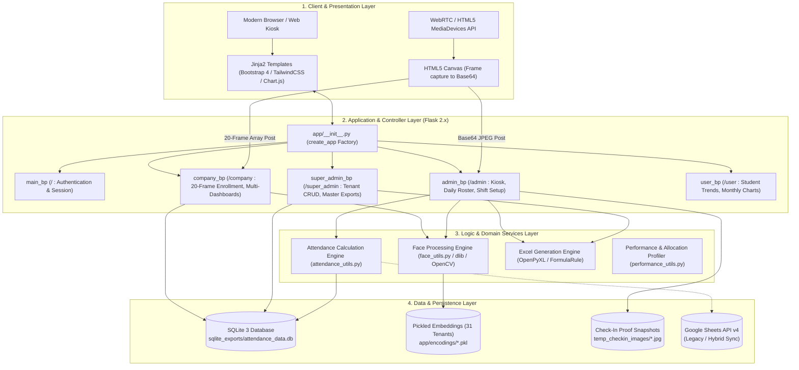
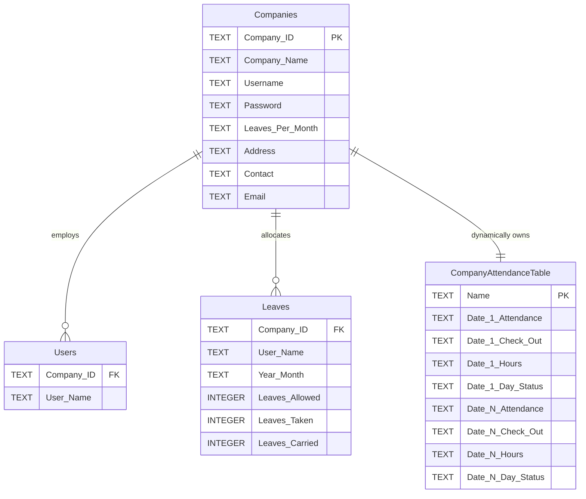

# AI Attendance Management System (AMS)
## Technical Architecture, Code Audit & Developer Engineering Guide

---

## 1. System Architecture & Component Design

The **AI Attendance Management System (AMS)** is a web-based computer vision application built on the **Flask** microframework using the **Application Factory Pattern**. It manages multi-tenant biometric attendance tracking using localized facial recognition embeddings, an embedded SQLite database, and optional Google Sheets cloud sync.

### 1.1 Layered Architecture Diagram



---

## 2. Blueprint & Module Decomposition

The backend code is partitioned into five distinct blueprints and an internal utilities library:

```
app/
├── __init__.py               # Application factory; blueprint registration & secret key
├── main/routes.py            # Authentication, role verification, session management
├── admin/routes.py           # Company admin panel, live attendance kiosk, force check-out
├── super_admin/routes.py     # Tenant company lifecycle, multi-tenant master excel exports
├── company/routes.py         # 20-frame burst user enrollment, company aggregate stats
├── user/routes.py            # Student dashboard, personal attendance history, Chart.js trends
└── utils/
    ├── db_utils.py           # SQLite connection factory & parameterized CRUD operations
    ├── face_utils.py         # Face encoding serialization, pickle loading, distance matching
    ├── attendance_utils.py   # Shift rules, IST timezone adjustments, hours arithmetic
    ├── performance_utils.py  # psutil/tracemalloc function execution and memory profiler
    ├── export_utils.py       # Google Sheets to SQLite dump script
    ├── google.py             # Google Sheets API v4 client initialization
    ├── helper.py             # Tenacity retry decorator wrapper for network calls
    └── redit_client.py       # Stub file for Redis integration
```

### 2.1 Route Registry & Responsibilities

| Blueprint | Route URL | Method | Function | Core Purpose |
| :--- | :--- | :--- | :--- | :--- |
| **`main_bp`** | `/` | `GET, POST` | `login` | Unified login screen; routes to Super Admin or Company Admin based on credentials. |
| | `/logout` | `GET` | `logout` | Clears Flask session and redirects to login. |
| **`admin_bp`** | `/admin/dashboard` | `GET, POST` | `admin_panel` | Primary company portal; shows today's roster, webcam kiosk, and force check-out. |
| | `/admin/setup_company_times` | `GET, POST` | `setup_company_times` | Sets shift check-in, check-out, and required working hours. |
| | `/admin/update_company_info` | `POST` | `update_company_info` | Updates company address, phone contact, and official email. |
| | `/admin/mark_attendance` | `POST` | `mark_attendance` | Manual administrative attendance entry/modification. |
| | `/admin/user_panel` | `GET, POST` | `user_panel` | **Core Kiosk API:** Receives webcam image, matches face, logs check-in/out. |
| | `/admin/history` | `GET, POST` | `history` | Date/User filterable historical attendance records. |
| | `/admin/download_attendance` | `GET` | `download_attendance` | Streams stylized OpenPyXL Excel workbook for the current company. |
| | `/admin/delete_user` | `GET` | `delete_user` | Deletes user record from database tables. |
| **`super_admin_bp`**| `/super_admin/dashboard` | `GET, POST` | `super_admin` | Global tenant management; creates and deletes partner companies. |
| | `/super_admin/get_overall_attendance` | `GET, POST` | `get_overall_attendance` | Cross-company Excel workbook export (Weekly, Monthly, 6-Month). |
| | `/super_admin/get_todays_attendance` | `GET` | `get_todays_attendance` | Single-day multi-company master attendance export. |
| **`company_bp`** | `/company/combined_dashboard` | `GET` | `combined_dashboard` | Overview of all companies with live daily user present/absent counts. |
| | `/company/company_dashboard/<id>` | `GET` | `company_dashboard` | Detailed drilldown into an individual company's student roster. |
| | `/company/add_user` | `GET, POST` | `add_user` | **Enrollment API:** Receives 20 webcam frames, extracts embeddings, registers user. |
| | `/company/download_company_attendance` | `GET` | `download_company_attendance` | Alternate company export endpoint. |
| | `/company/edit_company/<id>` | `GET, POST` | `edit_company` | Updates company metadata. |
| **`user_bp`** | `/user/student_dashboard/<cid>/<name>` | `GET` | `student_dashboard` | Student self-service portal with attendance graphs and leave balances. |

---

## 3. Biometrics & Computer Vision Pipeline

AMS implements a localized facial recognition pipeline built on Davis King's **dlib** C++ toolkit through the `face_recognition` Python wrapper.

```
[Raw Camera Stream]
        |
        v
[Webcam Canvas (HTML5)] ---> Base64 JPEG Frame
                                     |
                                     v
                          [Base64 Decode to Bytes]
                                     |
                                     v
                        [PIL Image RGB Conversion]
                                     |
                                     v
                   [Dlib HOG Face Detector (Locations)]
                                     |
                                     v
                     [ResNet-34 128-d Vector Encoder]
                                     |
                                     v
                   [Euclidean Distance Matching vs. PKL]
                                     |
                         +-----------+-----------+
                         |                       |
                    Distance < 0.45         Distance >= 0.45
                         |                       |
                         v                       v
                   [MATCH: Identify]     [REJECT: Unknown]
```

### 3.1 Feature Extraction Details
1. **Detection:** Images decoded from Base64 are converted into NumPy arrays ($H \times W \times 3$). The frontal face detector uses Histogram of Oriented Gradients (HOG) combined with a linear classifier:
   ```python
   face_locations = face_recognition.face_locations(rgb_frame, model="hog")
   ```
2. **Feature Mapping:** Faces are transformed through a 68-point facial landmark predictor to normalize orientation and alignment.
3. **Deep Residual Embeddings:** A pre-trained ResNet-34 network maps the aligned face into a **128-dimensional Euclidean space**:
   ```python
   face_encodings = face_recognition.face_encodings(rgb_frame, face_locations)
   # Returns List[np.ndarray], where each ndarray shape is (128,)
   ```

### 3.2 Metric Matching Algorithm
To identify a candidate face vector $V_c \in \mathbb{R}^{128}$ against known enrolled vectors $V_k \in \mathbb{R}^{128}$, the engine computes the Euclidean distance:

$$D(V_c, V_k) = \|V_c - V_k\|_2 = \sqrt{\sum_{i=1}^{128} (V_{c,i} - V_{k,i})^2}$$

In [`app/utils/face_utils.py:77-96`](file:///e:/tars/ams/student-managemnt-system/app/utils/face_utils.py#L77-L96):
- **Soft Tolerance Threshold:** $0.50$
- **Strict Verification Threshold:** $0.45$
```python
def find_best_match(face_encoding, known_faces, tolerance=0.5, strict_threshold=0.45):
    matches = []
    for current_name, known_encodings in known_faces.items():
        distances = face_recognition.face_distance(known_encodings, face_encoding)
        for distance in distances:
            if distance < tolerance:
                matches.append((current_name, distance))
    if matches:
        best_match = min(matches, key=lambda x: x[1])
        name, distance = best_match
        if distance < strict_threshold:
            return name, distance
    return None
```

### 3.3 Pickled Biometric Caching
To avoid re-training or re-extracting face embeddings on every request, face vectors are serialized into Python pickle files stored in `app/encodings/`:
- **Naming Convention:** `face_encodings_<Company_ID>.pkl`
- **Internal Data Structure:**
  ```python
  {
      "Student Name A": [np.ndarray((128,)), np.ndarray((128,)), ...], # up to 20 vectors
      "Student Name B": [np.ndarray((128,)), np.ndarray((128,)), ...]
  }
  ```
- **Enrollment Validation:** In [`app/company/routes.py:1142`](file:///e:/tars/ams/student-managemnt-system/app/company/routes.py#L1142), user registration requires a minimum of **5 valid face vectors** out of the 20 captured frames to prevent poor-quality enrollments.

---

## 4. Data Architecture & Database Schema

The production data is stored in a single SQLite 3 database located at [`sqlite_exports/attendance_data.db`](file:///e:/tars/ams/student-managemnt-system/sqlite_exports/attendance_data.db) (approx. 850 KB).



### 4.1 Schema Definitions

#### 1. `Companies` Table
Stores tenant organizations and credentials:
```sql
CREATE TABLE Companies (
    "Company ID" TEXT PRIMARY KEY,
    "Company Name" TEXT,
    "Username" TEXT UNIQUE,
    "Password" TEXT,
    "Leaves Per Month" TEXT,
    "Address" TEXT,
    "Contact" TEXT,
    "Email" TEXT
);
```

#### 2. `Users` Table
Associates employee and student names with their respective company tenant:
```sql
CREATE TABLE Users (
    "Company ID" TEXT,
    "User Name" TEXT
);
```

#### 3. `Leaves` Table
Tracks monthly leave consumption and carry-forward balances:
```sql
CREATE TABLE Leaves (
    "Company ID" TEXT,
    "User Name" TEXT,
    "Year-Month" TEXT,
    "Leaves Allowed" INTEGER,
    "Leaves Taken" INTEGER,
    "Leaves Carried" INTEGER
);
```

#### 4. Dedicated Dynamic Attendance Tables (`<COMPANY_ID>`)
Instead of a normalized relational design, the application creates a separate table for each company (e.g., `TARS_TECHNOLOGIES_PVT_LTD_01`). For each calendar day an employee logs attendance, the system runs `ALTER TABLE ADD COLUMN` to dynamically create 4 columns:
- `"<DD/MM/YYYY> Attendance"` (e.g., `"09:15:00 - 18:05:00"`)
- `"<DD/MM/YYYY> Check-out"` (e.g., `"18:05:00"`)
- `"<DD/MM/YYYY> Hours"` (e.g., `"8.83"`)
- `"<DD/MM/YYYY> Day Status"` (e.g., `"Full Day"`)

---

## 5. Comprehensive Code Audit & Vulnerability Report

A thorough inspection of the repository revealed several critical security flaws, unhandled exceptions, and design anti-patterns:

### 5.1 Critical Severity Findings

#### 1. Missing Template Exception on Route Access
- **File:** [`app/admin/routes.py:962`](file:///e:/tars/ams/student-managemnt-system/app/admin/routes.py#L962)
- **Code:**
  ```python
  @admin_bp.route('/user_panel', methods=['GET', 'POST'])
  def user_panel():
      ...
      return render_template('user_panel.html', name=name, action=action, known_faces=known_faces)
  ```
- **Vulnerability:** `user_panel.html` **does not exist** in `app/templates/`. Any browser navigating directly via `GET /admin/user_panel` will immediately trigger an unhandled `jinja2.exceptions.TemplateNotFound: user_panel.html` (HTTP 500 error).
- **Remediation:** Remove the GET handler or render `admin_panel.html` with an active kiosk modal.

#### 2. Missing Python Dependencies in `requirements.txt`
- **Files:** [`app/utils/performance_utils.py:3`](file:///e:/tars/ams/student-managemnt-system/app/utils/performance_utils.py#L3), [`app/utils/export_utils.py:5`](file:///e:/tars/ams/student-managemnt-system/app/utils/export_utils.py#L5)
- **Code:**
  ```python
  import psutil    # in performance_utils.py
  import pandas as pd # in export_utils.py
  ```
- **Vulnerability:** Neither `psutil` nor `pandas` is declared in [`requirements.txt`](file:///e:/tars/ams/student-managemnt-system/requirements.txt). In a clean virtual environment or fresh Docker build, the application will crash on startup with `ModuleNotFoundError: No module named 'psutil'`.
- **Remediation:** Add `psutil` and `pandas` to `requirements.txt`.

#### 3. Faulty File Paths in Company Deletion
- **File:** [`app/super_admin/routes.py:54-61`](file:///e:/tars/ams/student-managemnt-system/app/super_admin/routes.py#L54-L61)
- **Code:**
  ```python
  encodings_file = f'face_encodings_{delete_id}.pkl'
  if os.path.exists(encodings_file):
      os.remove(encodings_file)

  company_dir = os.path.join('path/to/images', delete_id)
  if os.path.exists(company_dir):
      shutil.rmtree(company_dir)
  ```
- **Vulnerability:** The code checks for pickle files in the project root directory, whereas all 31 pickle files reside in `app/encodings/`. As a result, deleting a company **fails to delete its facial recognition models**. Additionally, `'path/to/images'` is a hardcoded placeholder that does nothing.
- **Remediation:** Point `encodings_file` to `os.path.join('app', 'encodings', f'face_encodings_{delete_id}.pkl')` and clean up `temp_checkin_images`.

#### 4. Biometric Orphan Vulnerability upon User Deletion
- **File:** [`app/admin/routes.py:1344-1375`](file:///e:/tars/ams/student-managemnt-system/app/admin/routes.py#L1344-L1375)
- **Vulnerability:** The `delete_user` route deletes the row from SQLite's `Users` table and the company table, but **does not modify the `.pkl` file** in `app/encodings/`.
- **Impact:** The deleted user's facial vector remains in memory and on disk. If that person stands before the camera, the system still identifies them by name, attempts to log attendance against a non-existent DB row, and creates inconsistent states.
- **Remediation:** Update `delete_user` to load the company's pickle dictionary, `del encodings[name]`, and call `save_encodings()`.

#### 5. Simulated Random Attendance Data in Student Dashboard
- **File:** [`app/user/routes.py:100-120`](file:///e:/tars/ams/student-managemnt-system/app/user/routes.py#L100-L120)
- **Code:**
  ```python
  if record[4] == 'Present':
      present_data[i] = random.uniform(0.1, 0.9)
  elif record[4] == 'HalfDay':
      halfday_data[i] = random.uniform(0.1, 0.9)
  ```
- **Vulnerability:** The student dashboard visualizes attendance graphs using random floating-point values instead of genuine attendance numbers or binary 1.0/0.5 metrics.
- **Remediation:** Replace `random.uniform(0.1, 0.9)` with discrete status values ($1.0$, $0.5$, $0.0$).

---

### 5.2 High Severity Security Vulnerabilities

| Vulnerability | Attack Vector / Description | Severity | Fix |
| :--- | :--- | :--- | :--- |
| **Plaintext Password Storage** | Passwords for Super Admin and Company Admins are stored in raw plaintext in SQLite and checked via `user_data['Password'] == password`. | **CRITICAL** | Hash all passwords using `werkzeug.security.generate_password_hash` with `check_password_hash`. |
| **SQL Injection via f-strings** | Dynamic table creation and querying uses raw string interpolation: `f"SELECT * FROM '{company_table}'"` and `f"ALTER TABLE '{company_id}' ADD COLUMN..."`. | **HIGH** | Use parameterized queries for values, and strictly validate/whitelist table identifiers against regex `^[A-Za-z0-9_]+$`. |
| **Hardcoded Secret Key** | [`app/__init__.py:10`](file:///e:/tars/ams/student-managemnt-system/app/__init__.py#L10) hardcodes `app.secret_key = 'your-secret-key'`. | **HIGH** | Load from environment variable: `os.getenv('FLASK_SECRET_KEY')`. |
| **Dynamic Column Scalability Wall** | SQLite has a hard architectural maximum limit of 2,000 columns per table. The current design adds 4 columns per working day. | **HIGH** | After ~500 working days (~2 academic years), table alteration will crash SQLite. Must migrate to a normalized relational schema. |

---

### 5.3 Medium Severity Architectural & Code Quality Issues

1. **Unbounded Log File (`function_log.txt`):**
   - The `@measure_performance` decorator in [`app/utils/performance_utils.py`](file:///e:/tars/ams/student-managemnt-system/app/utils/performance_utils.py) writes execution time, RSS memory, and tracemalloc snapshots to `function_log.txt` on every route call.
   - The file is already **4.4 MB** in the repository and grows indefinitely, creating disk I/O bottlenecks.
2. **Orphaned Redis Code:**
   - [`app/utils/redit_client.py`](file:///e:/tars/ams/student-managemnt-system/app/utils/redit_client.py) (spelled with a 't') initializes `redis.Redis(host='localhost', port=6379)`, but Redis is not in `requirements.txt`, not in `compose.yaml`, and not imported anywhere in the app.
3. **Hardcoded Blocking Sleep in API Utility:**
   - [`app/utils/google.py:18-20`](file:///e:/tars/ams/student-managemnt-system/app/utils/google.py#L18-L20) executes `time.sleep(1)` unconditionally on every single API call to avoid Google rate limiting, locking the thread and degrading response time.

---

## 6. Developer Onboarding & Local Environment Setup

### 6.1 Prerequisites
- **Python:** Version 3.10 or 3.11 (Python 3.12+ can fail compiling dlib wheels).
- **C++ Compiler:**
  - **Windows:** Visual Studio Community Edition with *Desktop development with C++* and *CMake tools for Windows* selected.
  - **Linux (Ubuntu/Debian):**
    ```bash
    sudo apt-get update && sudo apt-get install -y \
        build-essential cmake gcc g++ make \
        libffi-dev libssl-dev libgl1-mesa-glx libglib2.0-0
    ```
  - **macOS:** `xcode-select --install` and `brew install cmake`.

### 6.2 Step-by-Step Local Setup

#### Step 1: Create and Activate Virtual Environment
```powershell
# In Windows PowerShell:
cd e:\tars\ams\student-managemnt-system
python -m venv venv
.\venv\Scripts\Activate.ps1
```

#### Step 2: Install Required Packages
```powershell
# Upgrade pip and install build wheel dependencies
pip install --upgrade pip setuptools wheel

# Install dependencies from requirements.txt + missing packages
pip install -r requirements.txt
pip install psutil pandas
```

#### Step 3: Configure Environment Variables
Create a `.env` file in `student-managemnt-system/`:
```env
SUPER_ADMIN_USERNAME=admin
SUPER_ADMIN_PASSWORD=change_this_in_production
GOOGLE_SHEET_ID=1fake_sheet_id_for_local_testing_only
GOOGLE_CREDENTIALS_JSON={"type": "service_account", "project_id": "test"}
FLASK_SECRET_KEY=generate_a_random_32_byte_hex_key
```

#### Step 4: Run the Development Server
```powershell
python run.py
```
The server will bind to `http://127.0.0.1:5000`.

---

## 7. Containerization & Production Deployment

### 7.1 Docker Architecture
The project includes a multi-stage [`Dockerfile`](file:///e:/tars/ams/student-managemnt-system/Dockerfile) and [`compose.yaml`](file:///e:/tars/ams/student-managemnt-system/compose.yaml).

```dockerfile
# Dockerfile Summary
ARG PYTHON_VERSION=3.9.14
FROM python:${PYTHON_VERSION}-slim as base

ENV PYTHONDONTWRITEBYTECODE=1
ENV PYTHONUNBUFFERED=1
WORKDIR /app

# Install native dependencies for dlib and OpenCV
RUN apt-get update && \
    apt-get install -y --no-install-recommends \
        build-essential cmake gcc g++ make \
        libffi-dev libssl-dev libatlas-base-dev \
        libgl1-mesa-glx libglib2.0-0 \
    && apt-get clean && rm -rf /var/lib/apt/lists/*

COPY requirements.txt .
RUN pip install -r requirements.txt
RUN pip install psutil pandas

COPY . .
EXPOSE 8000

CMD ["gunicorn", "run:app", "--bind=0.0.0.0:8000", "--workers=2", "--timeout=120"]
```

### 7.2 Docker Compose Execution
```powershell
# Build and run the container
docker compose up --build -d

# Check live logs
docker compose logs -f server
```
The application will be accessible at `http://localhost:8000`.

---

## 8. Refactoring Roadmap & Migration Strategy

For any developer assigned to modernize and scale this codebase, execute the following phased milestones:

```
+--------------------------------------------------------------------------+
|                       REFACTORING & MODERNIZATION                        |
+---------------------+------------------------------+---------------------+
|   MILESTONE 1       |        MILESTONE 2           |     MILESTONE 3     |
| Immediate Fixes     |  Security & DB Normalization | Scalability & Cloud |
| (Days 1 - 3)        |  (Weeks 1 - 2)               | (Month 1+)          |
+---------------------+------------------------------+---------------------+
| - Fix user_panel.html- Hash passwords with bcrypt  | - Migrate SQLite to |
| - Add psutil/pandas | - Migrate DB to Relational:   |   PostgreSQL        |
|   to requirements   |   attendance_records table   | - Move Pickles to   |
| - Fix delete_user   | - Replace raw SQL strings    |   Vector DB (pgvector|
|   pickle removal    |   with SQLAlchemy ORM        |   or Milvus)        |
| - Rotate logs       | - Replace random chart data  | - Add Celery worker |
+---------------------+------------------------------+---------------------+
```

### 8.1 Target Relational Database Schema
Replace the single-table dynamic column anti-pattern with a normalized table structure:

```sql
-- Target Relational Schema (PostgreSQL or SQLite)
CREATE TABLE companies (
    id VARCHAR(64) PRIMARY KEY,
    name VARCHAR(255) NOT NULL,
    username VARCHAR(100) UNIQUE NOT NULL,
    password_hash VARCHAR(255) NOT NULL,
    check_in_target TIME DEFAULT '09:00:00',
    check_out_target TIME DEFAULT '18:00:00',
    required_hours NUMERIC(4, 2) DEFAULT 8.0,
    leaves_per_month INTEGER DEFAULT 2,
    created_at TIMESTAMP DEFAULT CURRENT_TIMESTAMP
);

CREATE TABLE employees (
    id VARCHAR(64) PRIMARY KEY,
    company_id VARCHAR(64) REFERENCES companies(id) ON DELETE CASCADE,
    full_name VARCHAR(255) NOT NULL,
    is_active BOOLEAN DEFAULT TRUE,
    created_at TIMESTAMP DEFAULT CURRENT_TIMESTAMP
);

CREATE TABLE attendance_records (
    id INTEGER PRIMARY KEY AUTOINCREMENT,
    company_id VARCHAR(64) REFERENCES companies(id) ON DELETE CASCADE,
    employee_name VARCHAR(255) NOT NULL,
    date DATE NOT NULL,
    check_in_time TIME,
    check_out_time TIME,
    total_hours NUMERIC(4, 2),
    day_status VARCHAR(32), -- 'Full Day', 'Half Day', 'Absent'
    snapshot_path VARCHAR(512),
    created_at TIMESTAMP DEFAULT CURRENT_TIMESTAMP,
    UNIQUE(company_id, employee_name, date)
);
```

This normalized design allows indexing by date and company, eliminates SQLite's 2,000 column limit, and makes querying historical performance over arbitrary date ranges significantly faster.

