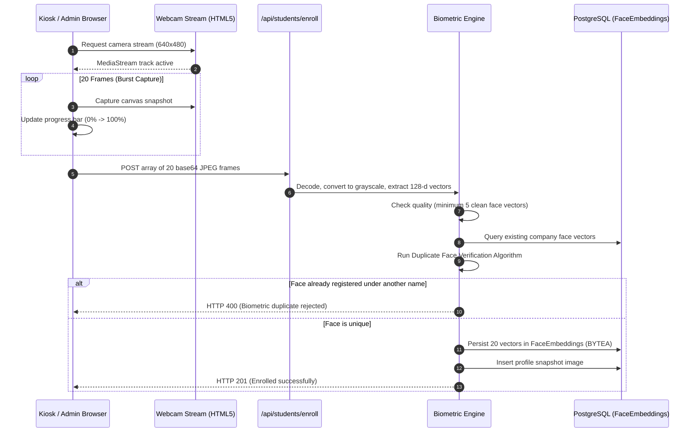
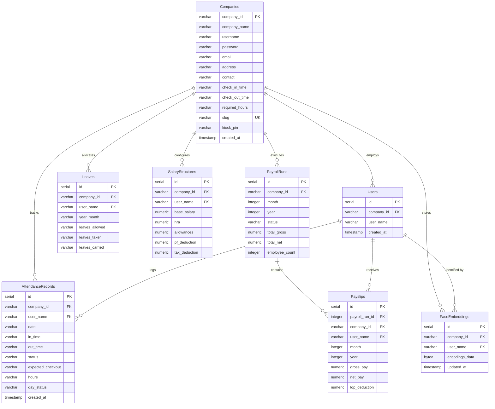

# Technical Architecture & System Specification
**Product:** Attendify AMS (Modern Cloud Biometric Attendance & Payroll Platform)  
**Version:** 3.0.0 (Production Release)  
**Last Updated:** November 2026  
**Document Classification:** Technical Architecture & Engineering Documentation  

---

## 1. Executive Architecture Summary

Attendify AMS is a high-performance, cloud-native, multi-tenant Biometric Attendance and Automated Payroll SaaS platform. The system operates on a decoupled client-server architecture:

```mermaid
graph TD
    ClientAdmin["Company Admin Dashboard (Vite + React SPA)"] -->|HTTPS / REST API + JWT Bearer| Backend["Flask REST Engine (Render Web Service / Gunicorn)"]
    ClientKiosk["Dedicated Kiosk Portal /kiosk/:orgSlug"] -->|HTTPS / Scoped JWT (Role: kiosk)| Backend
    
    subgraph Backend Core Services
        Backend --> AuthModule["Authentication & Tenant Gateway (JWT)"]
        Backend --> AttendanceModule["Live Attendance & Shift Calculator"]
        Backend --> BiometricEngine["128-d Biometric Vector Engine"]
        Backend --> PayrollModule["Automated Payroll & Payslip Engine"]
    end
    
    subgraph Data & Storage Layer
        Backend -->|psycopg2-binary Connection Pool| PostgreSQL["Managed PostgreSQL 16 (Render / Neon)"]
        Backend -->|Local Persistent FS / Object Store| Snapshots["Biometric Proof & Snapshot Store"]
    end

    PostgreSQL --- TableCompanies[("Companies (Tenants, Slugs, PINs)")]
    PostgreSQL --- TableUsers[("Users (Enrolled Profiles)")]
    PostgreSQL --- TableAttendance[("AttendanceRecords (Daily Logs)")]
    PostgreSQL --- TableLeaves[("Leaves (Balance Tracking)")]
    PostgreSQL --- TablePayroll[("SalaryStructures & Payslips")]
    PostgreSQL --- TableEmbeddings[("FaceEmbeddings (BYTEA Vectors)")]
```

---

## 2. Technology Stack & Component Specifications

| Tier | Component | Version | Purpose & Technical Role |
| :--- | :--- | :--- | :--- |
| **Frontend** | React | `18.3.1` | Modern component-based single page application (SPA) |
| **Frontend** | Vite | `5.4.21` | High-speed bundler, hot module reloading (HMR), production minifier |
| **Frontend** | React Router | `6.22.3` | Client-side routing with isolated kiosk routes (`/kiosk/:orgSlug`) |
| **Frontend** | CSS Architecture | Modern Glassmorphism | Custom design system (`ams-modern.css`) with zero third-party UI framework bloat |
| **Backend** | Python | `3.10.12` | Runtime environment for web services and numerical vector math |
| **Backend** | Flask | `3.1.0` | Lightweight RESTful microframework with Blueprint modular routing |
| **Backend** | WSGI Server | Gunicorn `20.0.4` | Production multi-worker process manager (`--workers 2 --timeout 120`) |
| **Backend** | CORS Management | Flask-CORS `6.0.5` | Universal preflight and origin echoing supporting cross-domain requests |
| **Biometrics** | NumPy | `2.5.4` | High-speed vector Euclidean distance calculations and array projections |
| **Biometrics** | Pillow (PIL) | `12.2.0` | Frame decoders, grayscale normalization, base64 image transforms |
| **Database** | PostgreSQL | `16.x` | Multi-tenant relational ACID store with binary vector embedding columns (`BYTEA`) |
| **DB Driver** | psycopg2-binary | `2.9.13` | High-throughput PostgreSQL driver with custom dictionary row wrapper |
| **Reporting** | OpenPyXL | `3.1.5` | Excel workbook generation with dynamic styling and color-coded attendance matrices |
| **Deployment** | Vercel | Production Edge | Global CDN edge hosting for React SPA with wildcard SPA rewrites |
| **Deployment** | Render | Production PaaS | Linux container hosting for Python WSGI service and managed PostgreSQL |

---

## 3. Biometric Computer Vision & Feature Embedding Engine

### 3.1 Feature Vector Representation
Every enrolled face is represented as a normalized 128-dimensional floating-point embedding vector:
$$\vec{v} = \begin{bmatrix} v_1, v_2, \dots, v_{128} \end{bmatrix} \in \mathbb{R}^{128} \quad \text{where} \quad \|\vec{v}\|_2 = \sqrt{\sum_{i=1}^{128} v_i^2} = 1.0$$

### 3.2 20-Frame Camera Burst Pipeline
During student enrollment, the frontend client captures 20 consecutive camera frames at 300ms intervals over a 6-second window. This ensures variations in head tilt, micro-expressions, and lighting are encoded into the student's biometric identity:



### 3.3 Mathematical Distance Metric & Thresholds
Biometric matching and duplicate detection employ Euclidean distance between normalized feature vectors:
$$D(\vec{u}, \vec{v}) = \|\vec{u} - \vec{v}\|_2 = \sqrt{\sum_{i=1}^{128} (u_i - v_i)^2}$$

Given two unit vectors ($\|\vec{u}\| = \|\vec{v}\| = 1$), Euclidean distance directly relates to cosine similarity:
$$D^2(\vec{u}, \vec{v}) = 2 - 2 \cos(\theta)$$

| Operation | Metric Threshold ($D$) | Equivalent Cosine Similarity | Operational Rule |
| :--- | :--- | :--- | :--- |
| **Positive Match (Attendance)** | $D < 0.45$ | $> 89.8\%$ | Verified match: Logs check-in or check-out |
| **Strict Quality Guard** | $D < 0.35$ | $> 93.8\%$ | High confidence biometric verification |
| **Duplicate Face Rejection** | $D < 0.35$ | $> 93.8\%$ | **Blocked:** Prevents re-enrolling under a second name |
| **Unknown / Reject** | $D \ge 0.45$ | $< 89.8\%$ | Unrecognized face; prompts user to face camera |

### 3.4 Anti-Duplication Enforcement
To ensure one physical individual cannot register under multiple employee names (e.g. enrolling as "Om Parkhi" and later as "Rahul"):
1. The backend iterates through all existing registered profiles in the tenant.
2. Pairwise distances are computed across all captured candidate vectors and existing vectors.
3. If $\min(D) < 0.35$ against another employee's profile, enrollment is halted with `HTTP 400 Bad Request`.

---

## 4. PostgreSQL Database Schema & Multi-Tenant Architecture

All company data is fully partitioned by `Company ID` (`company_id`). The system schema is initialized automatically on startup via `init_db_schema()`:



---

## 5. Security Architecture & Role-Based Isolation

### 5.1 Scoped JWT Security Matrix
The platform implements strict stateless authentication via JSON Web Tokens signed with HMAC-SHA256 (`HS256`):

| JWT Claim | Admin Token (`role: company_admin`) | Kiosk Token (`role: kiosk`) |
| :--- | :--- | :--- |
| **Token Lifetime** | 24 Hours | 30 Days |
| **Issuance Method** | Username & Password Login (`/api/auth/login`) | Kiosk 6-Digit PIN Validation (`/api/kiosk/verify-pin`) |
| **Allowed Actions** | Full tenant admin, payroll runs, settings, Excel export | Biometric scan, self-enrollment, today's attendance |
| **Restricted Actions** | Cannot access other companies' partitioned rows | **Blocked with HTTP 403 Forbidden** from `/api/payroll/*` |

### 5.2 Python `@admin_only` Security Guard
Every confidential administrative route is wrapped with the `@admin_only` decorator:

```python
def admin_only(f):
    @wraps(f)
    def decorated(current_user, *args, **kwargs):
        if current_user.get('role') == 'kiosk':
            return jsonify({
                'error': 'Access Denied: Confidential payroll data is restricted to company administrators.'
            }), 403
        return f(current_user, *args, **kwargs)
    return decorated
```

### 5.3 Front-Desk Kiosk Terminal Isolation
1. **Public URL:** The kiosk is addressed by organization slug: `/kiosk/:orgSlug` (e.g., `/kiosk/acme`).
2. **Access Gate:** Opening the terminal requires the 6-digit Kiosk PIN shared by the administrator.
3. **Session Persistence:** Scoped kiosk token is held in `localStorage` (`ams_kiosk_token_<slug>`) to allow persistent front-desk tablet operation without repeated daily logins.
4. **Data Privacy:** Even if an employee inspects the browser DevTools network tab on a kiosk tablet, all administrative endpoints return `403 Forbidden`. Employee salary details and individual absence records are completely inaccessible.

---

## 6. Comprehensive API Endpoint Specification

### 6.1 Authentication & Tenant Management
- `POST /api/auth/register`: Creates new company tenant, hashes password via Werkzeug PBKDF2-SHA256, generates unique URL slug and random 6-digit Kiosk PIN.
- `POST /api/auth/login`: Authenticates company administrator, returns 24-hour admin JWT.
- `GET /api/auth/me`: Returns tenant metadata, current user role, shift timings, and slug.

### 6.2 Organization Kiosk Portal
- `GET /api/kiosk/org/<slug>`: Public endpoint returning organization name, shift hours, and `requires_pin: true`.
- `POST /api/kiosk/verify-pin`: Validates 6-digit PIN against `Companies` table and issues 30-day scoped `kiosk_token`.
- `GET /api/company/kiosk-settings`: Admin endpoint returning current slug, PIN, and shareable URL.
- `POST /api/company/kiosk-settings`: Admin endpoint to update slug or dynamically regenerate a new PIN.

### 6.3 Biometrics & Attendance
- `POST /api/kiosk/scan`: Processes live webcam image, identifies student, calculates time elapsed, logs Check-In or Check-Out, and saves permanent check-in snapshot proof.
- `POST /api/students/enroll`: Receives student name and 20 base64 JPEG frames, verifies face uniqueness against all existing students, persists 128-d vectors in `FaceEmbeddings`, and saves profile portrait.
- `GET /api/students`: Returns all registered students with vector counts and profile photo URLs.
- `DELETE /api/students/<name>`: Purges student records across all database tables and removes biometric encodings.
- `GET /api/attendance/today`: Returns live daily attendance roster, status badges, and snapshot proof URLs.
- `GET /api/attendance/snapshot/<filename>`: Serves JPEG check-in snapshot proof or profile portraits.
- `GET /api/attendance/export-excel`: Generates color-coded multi-column attendance workbook for specified month/year.

### 6.4 Payroll & Compensation (Admin Only)
- `GET /api/payroll/members`: Lists all members with base salary and configured salary structures.
- `POST /api/payroll/salary`: Updates monthly base stipend/salary for an employee.
- `GET /api/payroll/calculate`: Computes monthly gross pay, biometric hours worked, loss of pay (LOP), and net salary.
- `POST /api/payroll/finalize`: Locks and approves the monthly payroll run, generating immutable itemized payslips.
- `GET /api/payroll/history`: Retrieves previous approved monthly payroll runs.
- `GET /api/payroll/payslip`: Fetches individual itemized payslip breakdown for print/PDF generation.

---

## 7. Cloud Deployment & Operational Resilience

### 7.1 PostgreSQL Connection Management
To support Render's PostgreSQL connection pooling and URI formats, `app/utils/db_utils.py` automatically normalizes connection strings:
- Replaces legacy `postgres://` prefixes with standard `postgresql://`.
- Encapsulates queries in `PGConnectionWrapper` to maintain backward-compatible SQLite-like dictionary access (`row['User Name']`).
- Uses parameterized `%s` queries throughout to prevent SQL injection vulnerabilities.

### 7.2 Static Asset & Proof Snapshot Storage
- Daily attendance check-in photos and reference portraits are stored in `temp_checkin_images/` on persistent local disk or mapped volume mounts.
- Files are named with tenant and date isolation: `<company_id>_<user_name>_<dd-mm-yyyy>.jpg`.
- Check-in snapshots are **never deleted on checkout**, ensuring supervisory audit logs remain intact indefinitely.
