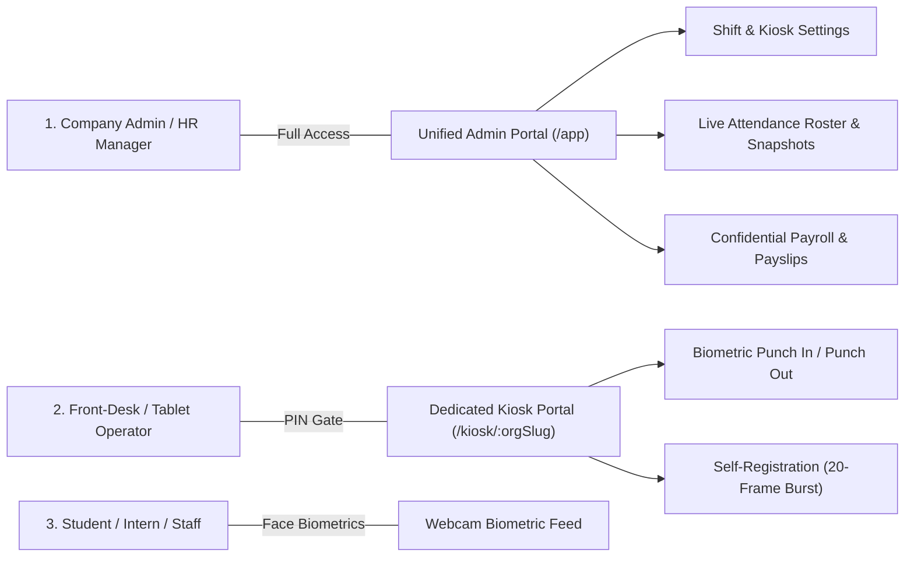
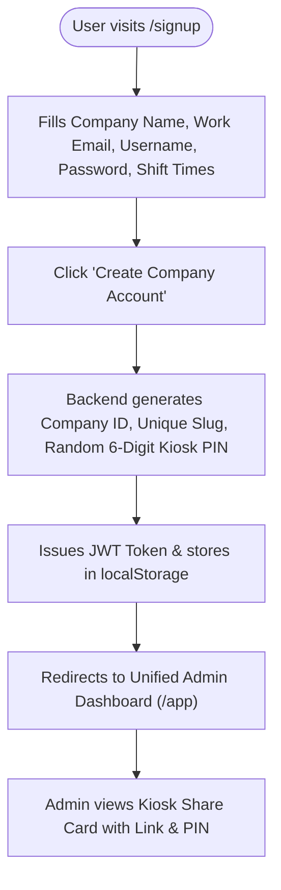
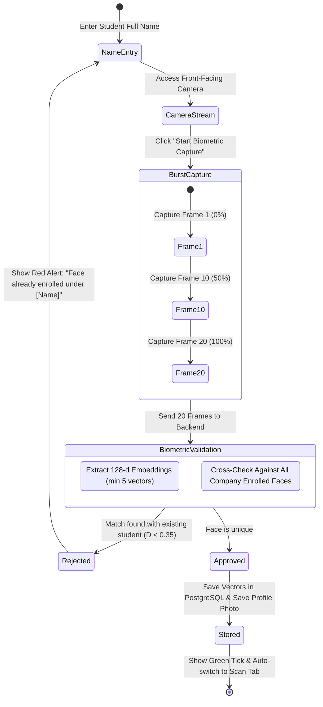
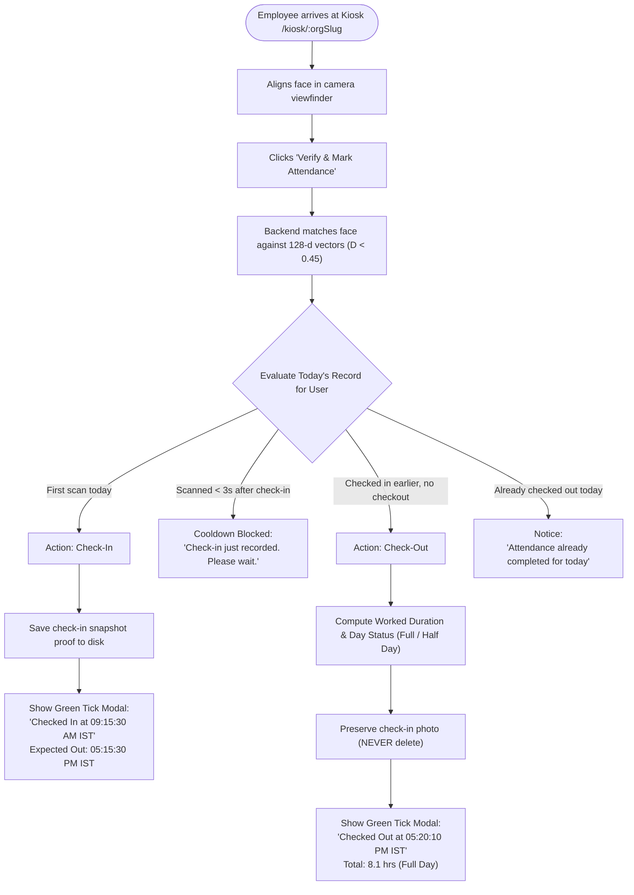
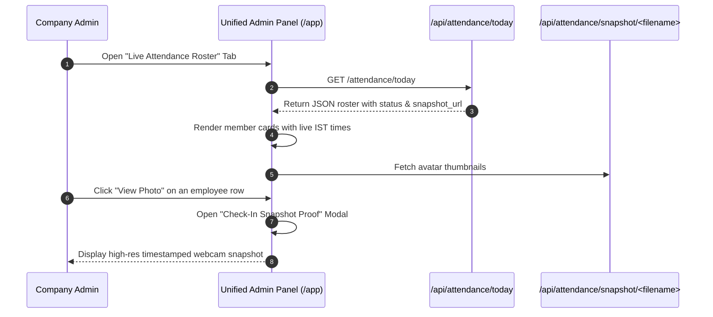
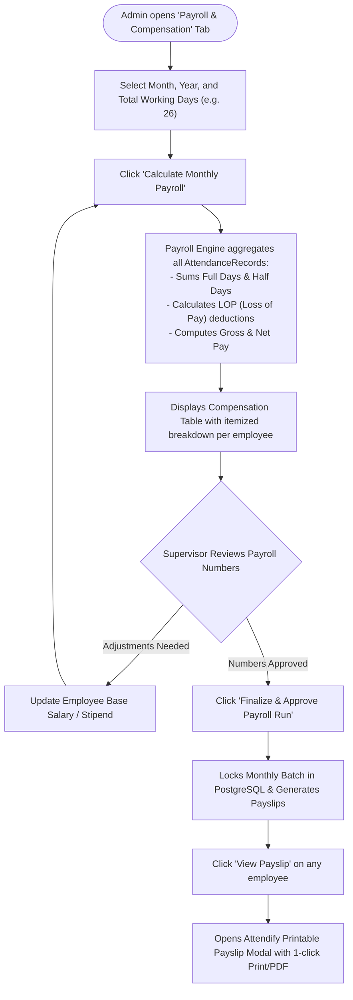

# User Flow & Operational Journey Documentation
**Product:** Attendify AMS (Modern Cloud Biometric Attendance & Payroll Platform)  
**Version:** 3.0.0 (Production Release)  
**Target Audience:** Product Teams, HR Administrators, Reception Supervisors, Engineering  

---

## 1. System Personas & Permission Levels

| Persona | Primary Interface | Authentication Required | Accessible Features | Security Boundaries |
| :--- | :--- | :--- | :--- | :--- |
| **Company Admin / HR** | `/app` (Admin Portal) | Username + Password (JWT) | Dashboard analytics, Shift setup, Live roster, Manual overrides, Excel exports, Payroll processing, Payslips | Partitioned by `Company ID`; strictly cannot view other tenants |
| **Front-Desk Kiosk** | `/kiosk/:orgSlug` | 6-Digit Kiosk Access PIN | Touchscreen face scan, Check-in / Check-out, Student self-enrollment, 12-hr IST clock | **Zero access** to payroll, employee salary figures, or global settings (`403 Forbidden`) |
| **Student / Intern** | Camera Viewfinder | Face Biometrics (128-d) | Face scan, instant visual verification tick modal, personal expected checkout notification | Cannot tamper with logs or access administrative endpoints |

---

## 2. End-to-End User Journeys

### Journey 1: Tenant Onboarding & Organization Setup

1. **Sign-Up Entry (`/signup`):**
   - The organization administrator navigates to `/signup`.
   - Admin provides:
     - Company Name (e.g. `Acme Corp`)
     - Work Email (e.g. `hr@acme.com`)
     - Admin Username & Password
     - Daily Shift Timings (Shift Start, Shift End, Required Daily Hours, e.g. `09:00 AM - 06:00 PM`)
2. **Automated Tenant Initialization:**
   - The backend provisions a unique `Company ID` (`Acme_Corp_01`).
   - Generates a custom web-friendly URL slug (`/kiosk/acme-corp`).
   - Issues a cryptographically random 6-digit Kiosk PIN (e.g. `749213`).
   - Creates the dedicated multi-tenant tables in PostgreSQL.
3. **Landing on Dashboard:**
   - The admin is immediately redirected to the **Unified Admin Panel** (`/app`).
   - The top banner on the Overview tab showcases the shareable Kiosk link and PIN.

---

### Journey 2: Student / Intern Biometric Self-Enrollment

This workflow can occur directly on the **Front-Desk Kiosk (`/kiosk/:orgSlug`)** or from the **Admin Panel (`Enroll Student` modal)**:

1. **Student Approaches Terminal:**
   - Selects the **New Intern / Student Enrollment** tab.
   - Enters their full name (e.g., `Om Parkhi`).
2. **Camera Alignment & Burst Capture:**
   - Camera preview activates.
   - User clicks **Start Biometric Capture**.
   - Over 6 seconds, 20 consecutive frames are captured at 300ms intervals, providing a smooth animated progress bar (0% $\to$ 100%).
3. **Biometric Validation & Duplicate Check:**
   - The backend validates lighting and extracts 128-dimensional feature vectors.
   - **Anti-Duplication Guard:** The candidate vectors are cross-checked against all existing enrolled employees.
   - If the face matches an already registered user, enrollment is stopped with an alert:  
     `"Biometric validation failed: This face is already enrolled under [Existing Name]. A student cannot be registered multiple times under different names."`
4. **Completion:**
   - If unique, the vectors are saved into `FaceEmbeddings`, and frame 0 is stored as their permanent profile photo.
   - A green confirmation message appears, and the kiosk switches to the Scan tab.

---

### Journey 3: Daily Front-Desk Kiosk Attendance Punch (Check-In & Check-Out)

1. **Punch In (Morning):**
   - Employee walks up to the reception tablet and clicks **Verify & Mark Attendance**.
   - Biometric engine matches face in $< 500\text{ ms}$.
   - Check-in timestamp is recorded in Indian Standard Time (12-hour AM/PM format, e.g., `09:14:22 AM IST`).
   - Expected check-out time is calculated based on company policy (`05:14:22 PM IST`).
   - Check-in snapshot proof is captured and permanently stored for admin review.
   - Animated green right-tick modal pops up and automatically dismisses after 3.8 seconds.
2. **Accidental Rescan Guard:**
   - If the student taps the button again within 3 seconds, a friendly cooldown notice prevents duplicate check-in.
3. **Punch Out (Evening):**
   - Employee returns at the end of the shift and taps the scan button.
   - The system recognizes prior check-in, calculates exact elapsed hours, categorizes day status (`Full Day` if $\ge \text{required hours}$, else `Half Day`).
   - The morning check-in snapshot proof is **safely retained** for supervisory compliance.

---

### Journey 4: Admin Live Monitoring & Snapshot Review

1. **Dashboard Overview:**
   - Real-time statistics: Total Enrolled, Present Today, Absent Today, Completed Today.
   - Work hours area chart and presence donut gauge update dynamically.
2. **Live Roster Inspection:**
   - Tab displays every enrolled student with status chips (`Present`, `Absent`), punch-in time, punch-out time, hours logged, and day status.
3. **Biometric Snapshot Proof:**
   - Every checked-in employee row displays a **"View Photo"** button and avatar thumbnail.
   - Clicking opens the high-resolution modal preview of the exact photo taken at the front-desk camera during punch-in.
4. **Administrative Overrides:**
   - If an employee forgot to scan out, the supervisor can click **Force Checkout**.
   - If a camera was down, the supervisor can execute **Manual Check-In**.

---

### Journey 5: End-of-Month Automated Biometric Payroll

1. **Automated Computation:**
   - Admin opens the Payroll tab and selects the pay period (e.g., November 2026, 26 working days).
   - Biometric attendance data directly informs compensation:
     $$\text{Present Days} = \text{Full Days} + (0.5 \times \text{Half Days})$$
     $$\text{Absent Days} = \text{Working Days} - \text{Present Days} - \text{Approved Leaves}$$
     $$\text{Daily Rate} = \frac{\text{Base Salary}}{\text{Working Days}}, \quad \text{LOP Deduction} = \text{Absent Days} \times \text{Daily Rate}$$
     $$\text{Net Pay} = \text{Gross Salary} - \text{LOP} - \text{PF} - \text{Taxes}$$
2. **Finalization & Audit Lock:**
   - Clicking **Finalize Payroll** writes the record to `PayrollRuns` and freezes the figures against retroactive edits.
3. **Printable Branded Payslips:**
   - Supervisors can generate itemized payslips formatted with the company name, working days, gross earnings, itemized deductions, and net pay in Indian Rupees (`₹`).

---

### Journey 6: Administrative Kiosk Terminal Sharing & PIN Rotation

1. **Kiosk Share Banner:**
   - Displayed directly on the Overview tab of the Admin Panel.
   - Shows the active organization URL slug (`/kiosk/acme`).
   - **Copy Link Button:** 1-click copies the full HTTPS link to clipboard.
2. **PIN Security Controls:**
   - Toggle eye button reveals or hides the 6-digit PIN (`••••••` $\leftrightarrow$ `183678`).
   - **Regen Button:** Dynamically generates a new random PIN in PostgreSQL; immediately revokes old terminal sessions for complete security rotation.
   - **Launch Button:** Opens the terminal in a clean browser tab for front-desk mounting.

